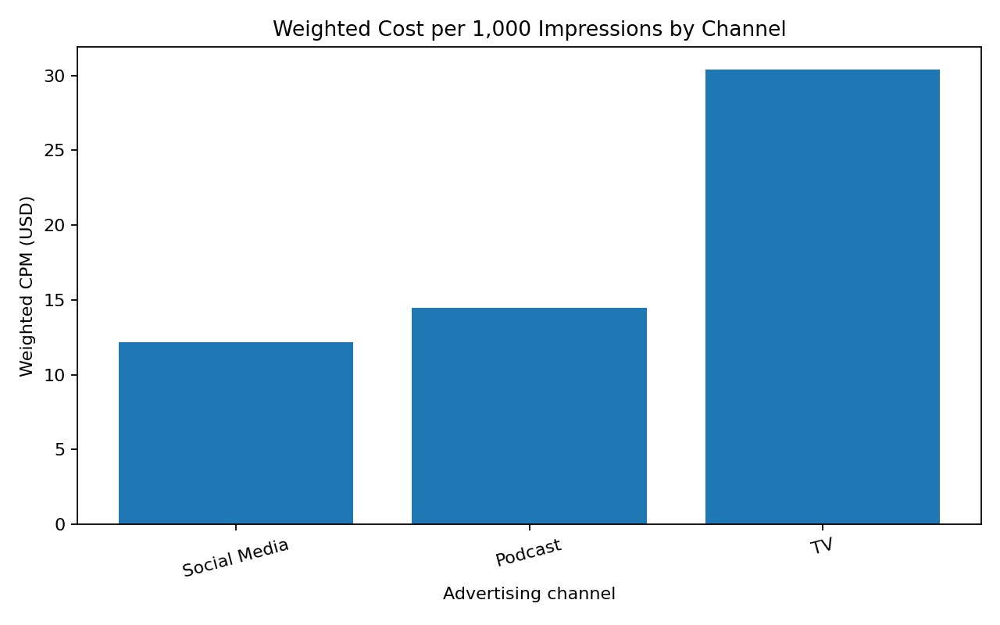
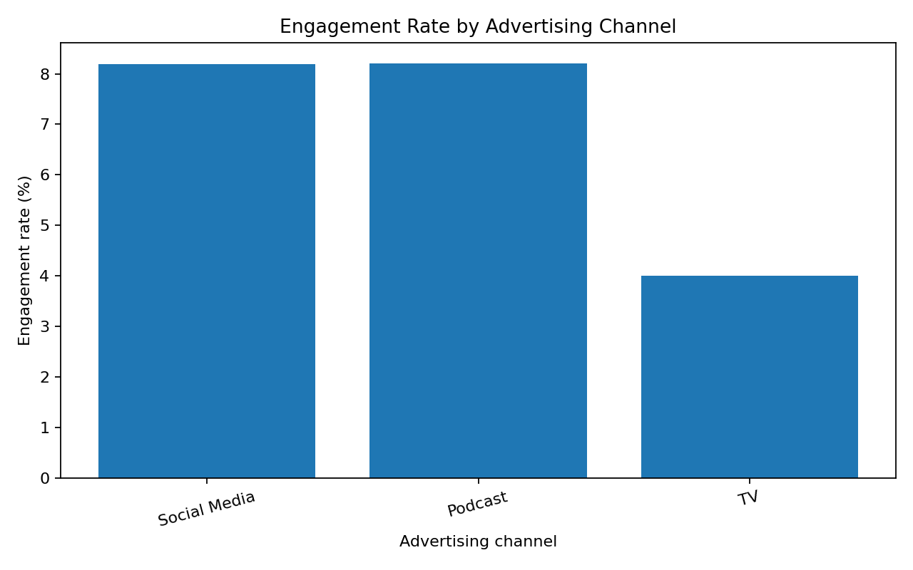

# Anywhere Gaming Repair — Marketing Channel Optimization & Analytics Case Study

[](https://www.python.org/)
[](https://www.sqlite.org/)
[](https://www.tableau.com/)
[](https://pandas.pydata.org/)
[](https://opensource.org/licenses/MIT)

An end-to-end data analytics case study evaluating advertising channel efficiency across **Podcast**, **Social Media**, and **TV** campaigns. This project applies the 6-phase data analysis framework (Ask, Prepare, Process, Analyze, Share, Act) to formulate a data-driven, budget-constrained marketing allocation strategy for **Anywhere Gaming Repair** targeting gamers aged 18–34.

---

## 📌 Executive Summary

Anywhere Gaming Repair is a mobile gaming device repair service seeking to optimize its monthly advertising spend ($2,000 budget) to maximize reach and customer engagement among gamers aged 18–34.

### Key Takeaways:
- **Most Cost-Efficient Reach:** **Social Media** achieved the lowest weighted CPM (**$12.20**), making it 15.6% cheaper than Podcasts and 59.9% cheaper than TV.
- **Top Engagement:** **Podcasts** (**8.21%**) and **Social Media** (**8.20%**) delivered more than double the engagement rate of **TV** (**4.00%**).
- **Budget Recommendation ($2,000/mo Cap):** Eliminate TV spend; allocate a **60/40 split** ($1,200 Social Media / $800 Podcast Sponsorship) to balance low-cost retargeting with high-trust gaming creator endorsements.

---

## 📊 Analytics Summary & Findings

| Media Channel | Campaigns Analyzed | Total Spend (USD) | Total Impressions | Total Engagements | Weighted CPM ($) | Engagement Rate (%) |
| :--- | :---: | :---: | :---: | :---: | :---: | :---: |
| **Social Media** | 3 | $2,500 | 205,000 | 16,800 | **$12.20** | **8.20%** |
| **Podcast** | 4 | $3,500 | 242,000 | 19,860 | **$14.46** | **8.21%** |
| **TV** | 2 | $3,800 | 125,000 | 5,000 | **$30.40** | **4.00%** |

### Visual Comparisons

<p align="center">
  
  
</p>

- **Weighted CPM by Channel:** Social Media provides the most scalable top-of-funnel reach, with Podcasts as a strong second. TV requires substantial investment for significantly fewer impressions.
- **Engagement Rate by Channel:** Community-driven channels (Podcasts & Social Media) resonate significantly stronger with the 18–34 demographic than broadcast television.

---

## 🧭 The Six Data Analytics Phases

### 1. Ask
- **Business Question:** Which advertising channels deliver the highest efficiency (lowest CPM) and strongest audience engagement within a constrained monthly budget of $2,000?
- **Primary Stakeholder Goal:** Determine the optimal allocation of ad spend targeting gamers aged 18–34.
- **Core Metrics:**
  - **CPM (Cost per Thousand):** `(Spend / Impressions) * 1,000`
  - **Weighted CPM:** `(Total Spend / Total Impressions) * 1,000`
  - **Engagement Rate:** `(Engagements / Impressions) * 100`

### 2. Prepare
- **Data Source:** Synthetic marketing dataset (`data/ad_market_data.csv`) simulating performance across multi-channel campaigns.
- **Attributes:** Media channel, target age group, monthly spend, impressions, engagements, recorded CPM, and campaign notes.
- **Integrity & Privacy:** Practice data containing no proprietary or personally identifiable information (PII).

### 3. Process
- **Data Cleaning & Standardization (Python & SQL):**
  - **Whitespace Stripping:** Trimmed leading/trailing spaces across channel names (e.g., `' Podcast '` → `'Podcast'`).
  - **Demographic Filtering:** Filtered specifically to target segments (`'18-34'` and `'25-34'`), excluding out-of-scope age brackets (`'35-54'`).
  - **Imputation:** Calculated and populated missing CPM values using `(monthly_spend_usd * 1000.0) / impressions`.
  - **Type Casting:** Enforced strict numeric types across spend, impressions, and engagements.

### 4. Analyze
- Aggregated campaign performance at the channel level.
- Used **weighted CPM** rather than arithmetic mean CPM to avoid distortions caused by varying campaign sizes.
- Filtered individual campaigns complying with the $2,000 monthly ceiling to evaluate single-campaign options.

### 5. Share
- Generated high-resolution comparative bar charts via Python (`matplotlib`).
- Packaged clean, structured datasets in `outputs/channel_summary.csv` and `outputs/cleaned_campaign_data.csv`.
- Created an interactive Tableau workbook (`Anywhere_Gaming_Repair_Marketing.twbx`) for stakeholder review.

### 6. Act (Recommendations)
1. **Reallocate Capital Away From TV:**
   - TV ads exhibit the highest CPM ($30.40) and lowest engagement (4.00%), making them inefficient for this niche demographic.
2. **Implement a 60/40 Digital & Audio Split ($2,000/mo):**
   - **$1,200 to Social Media:** Drives ~98,000 impressions via video ads and retargeting campaigns at an estimated $12.20 CPM.
   - **$800 to Gaming Podcasts:** Drives ~55,000 impressions via trusted host-read endorsements at ~8.2% engagement.
3. **Future Measurement & Attribution:**
   - Implement UTM tracking, dedicated promo codes (e.g., `REPAIR10`), and landing page conversion tracking to connect engagements directly to completed repair bookings.

---

## 🗂️ Project Structure

```text
anywhere_gaming_repair_project/
├── data/
│   └── ad_market_data.csv                  # Raw campaign dataset
├── outputs/
│   ├── channel_summary.csv                 # Aggregated metrics by channel
│   ├── cleaned_campaign_data.csv           # Processed and cleaned data
│   ├── engagement_rate.png                 # Engagement rate comparison chart
│   └── weighted_cpm.png                    # Weighted CPM comparison chart
├── sql/
│   └── analysis.sql                        # SQL queries for cleaning, aggregation, & budget filtering
├── src/
│   └── analyze.py                          # Python data pipeline & visualization script
├── Anywhere_Gaming_Repair_Marketing.twbx   # Tableau Packaged Workbook
├── requirements.txt                        # Python dependencies
├── .gitignore                              # Git exclusion rules
└── README.md                               # Project documentation & portfolio report
```

---

## 💻 Tech Stack & Tools

- **Languages:** Python 3, SQL (SQLite-compatible)
- **Libraries:** Pandas (data transformation), Matplotlib (visualization)
- **Business Intelligence:** Tableau Desktop / Tableau Public
- **Environment & Version Control:** VS Code, Git, GitHub

---

## 🚀 How to Run the Analysis Locally

### 1. Clone the Repository
```bash
git clone https://github.com/shraishwarya/Anywhere-Gaming-Repair-Marketing-Optimization.git
cd Anywhere-Gaming-Repair-Marketing-Optimization
```

### 2. Set Up Virtual Environment
```bash
python -m venv .venv
# On Windows:
.venv\Scripts\activate
# On macOS/Linux:
source .venv/bin/activate
```

### 3. Install Dependencies
```bash
pip install -r requirements.txt
```

### 4. Execute Analysis Pipeline
```bash
python src/analyze.py
```
*Outputs will be generated and saved in the `outputs/` directory.*

### 5. Run SQL Queries
You can run `sql/analysis.sql` using any SQLite client (e.g., DB Browser for SQLite, DBeaver, or SQLite CLI):
```bash
sqlite3 anywhere_gaming.db < sql/analysis.sql
```

---

## 📌 Disclaimer
The dataset used in this project is synthetic practice data constructed for analytical modeling and portfolio demonstration. Real-world business deployment would require continuous conversion tracking and multi-touch attribution.

---

## 👤 Author
**Shri Aishwarya Nagasundaram**  
- GitHub: [@shraishwarya](https://github.com/shraishwarya)  
- LinkedIn: [Connect on LinkedIn](https://www.linkedin.com/)
